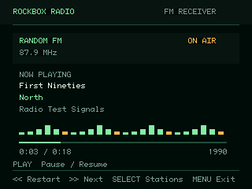

# Rockbox Radio

Rockbox Radio is an offline FM-style player for the Apple iPod Video 5G and 5.5G. It plays files already on the iPod through Rockbox's native playlist and audio engine.



## Install

1. Check **System → Rockbox Info**. The included device binary targets Rockbox 4.0 on the iPod Video. For another firmware build, compile from that build's matching source if the plugin ABI differs.
2. Download `rockbox_radio.rock` from [Releases](../../releases), then copy it to `/.rockbox/rocks/apps/` on the iPod.
3. In Rockbox, open **Database** and initialize it if needed. Follow Rockbox's prompt to reboot or finish importing. Update the database after adding or retagging music.
4. Open **Plugins → Applications → rockbox_radio**. Surprise Start is enabled on first launch. Press **Select** to open the stations or **Menu** to cancel tuning.

## Stations and controls

| Station | Music |
| --- | --- |
| RANDOM FM | All tracks in the Rockbox database, including tracks with missing or unknown years |
| CUSTOM ERA FM | Choose 1970s, 1980s, 1990s, 2000s, or 2010s. The most recent choice is highlighted when you return. |
| 90s & 00s FM | Tracks tagged 1990 through 2009, inclusive |

| Control | Action |
| --- | --- |
| Clickwheel | Move through stations, eras, and settings |
| Select | Open stations from the tuner or confirm a menu item |
| Next | Skip the current track |
| Previous | Restart the current track |
| Play/Pause | Pause or resume. From standby, tune to the remembered station. |
| Menu | Cancel tuning, go back, or exit from the tuner |
| Previous or Next in Settings | Adjust the delay. Select also toggles on/off settings. |

**Surprise Start** tunes to the last station, or to RANDOM FM on first launch. The default delay is a random whole number from zero to eight seconds. Both bounds are adjustable up to 30 seconds. **Random position** is off by default. When enabled, Surprise Start requests a point between 10% and 90% into a track of at least ten seconds. The settings screen also controls station recall, full-cycle repetition and artist separation. Settings are written to the iPod and persist across reboot.

Each station and each custom era keeps its own queue and full-cycle history while the tuner is open. By default, automatic track selection walks through all eligible tracks before repeating a track in that station, skips unavailable paths, and picks a different tagged artist whenever one remains. The tuner shows title, artist, album, year when available, and elapsed time. The frequency labels and animated level bars are decorative.

## Build from source

The patch includes the complete C source and registers it in Rockbox's plugin source list and Applications category. The [standalone C source](rockbox_radio.c) is included for browsing.

Run these commands from a shell with Rockbox's ARM build tools on PATH.

```sh
git clone --branch v4.0-final https://github.com/Rockbox/rockbox.git
cd rockbox
git apply /path/to/rockbox-radio.patch
mkdir build-radio
cd build-radio
../tools/configure --target=ipodvideo --type=n
make -j4
```

The binary is `build-radio/apps/plugins/rockbox_radio.rock` relative to the source root. `make zip` places it in `.rockbox/rocks/apps/` inside the Rockbox package. The reference revision is `e094c599fa60236527f9e272e0b8309d7696e399` and the device plugin API is 273. [Rockbox 4.0 source](https://github.com/Rockbox/rockbox/tree/v4.0-final)

See the [Windows build notes](docs/windows-build.md) for the toolchain and path adjustments used for the released binary.

To build an SDL simulator on Linux, use a second build directory and configure it with `--target=ipodvideo --type=s`, then run `make` and `make install`.

## Verification

- Built the device binary with Arm GNU 13.3.1 and the Rockbox `ipodvideo` linker script. Checked the emitted Rockbox header, target ID 15, plugin API 273, and ARM entry point. The source patch passes `git apply --check` against the release index.
- Ran the iPod Video SDL simulator with eight synthetic tagged MP3s and captured decoded PCM. The fixture covered missing years and the 1989/1990 and 2009/2010 boundaries. Verified metadata display, fresh shuffle order, artist separation when alternatives remained, pause/resume, track skip and restart, automatic advance, and queue refill.
- Verified settings across a simulator restart, a Surprise Start that joined an MP3 at 0:15 of 0:18, and continued PCM output after leaving the plugin. Verified launch through Plugins → Applications and the messages for an unavailable database and an era with an inaccessible matching track.
- Physical iPod behavior remains unverified.

## Known limitations

- Rockbox's Database is required. Radio takes a single snapshot per launch, when you first tune. Library updates are picked up on the next launch. Initial indexing on a large library can take longer than the selected startup delay.
- Repeat history and pending queues reset when the plugin is closed. While Radio is open, Rockbox's Repeat mode is temporarily set to Off. Radio restores the prior mode on exit.
- Launching a station replaces Rockbox's current playback queue. Saved playlists and music files stay intact. On exit, Rockbox can keep playing the currently loaded batch of up to 24 tracks. Radio's station scheduler runs only while the plugin is open. A new batch may introduce a short gap.
- Codec support determines whether seeking to a random time works. Missing metadata may produce a filename and placeholder artist or album, and unknown years are excluded from era stations.
- The index holds about 36,000 tracks on the 512 KiB iPod Video plugin buffer. Larger libraries show a capacity message. Radio stores its settings, two working playlists, and a temporary path catalog under `/.rockbox/rocks/apps/rockbox-radio/`.

## License

The plugin is licensed under GPL-2.0-or-later. The upstream Rockbox code retains its original notices. See [LICENSE](LICENSE) and the pinned Rockbox source referenced above.
